<html lang="ja">
    <head>
        <meta charset="utf-8" />
    </head>
    <body>
        <h1>
RgbDepth
</h1>
        <h2>なにものか？</h2>
        

            RGB画像とdepth画像を指定して、3Dオブジェクトを表示します。 
             
            入力画像 
            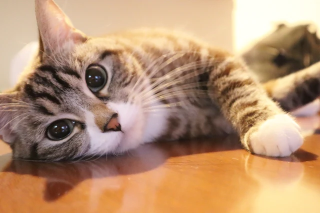 
            3Dオブジェクト表示 
            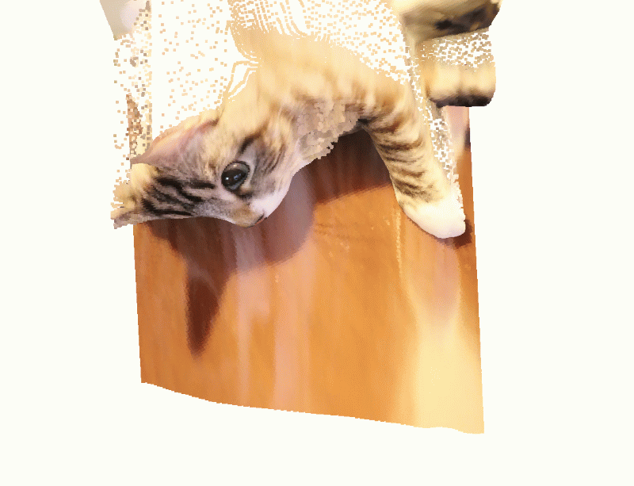
        

        <h2>環境構築方法</h2>
        

            pip install opencv-python open3d
        

        <h2>使い方</h2>
        

            python  RgbDepth.py  (RGB画像ファイル)  (depth画像ファイル)  [(Zscale) (fx) (fy) (cx) (cy)] 
            ※ ピクセルとz値の比率が不明のため、Zscale引数で調整します。 
               その他のパラメータは下図参照 
            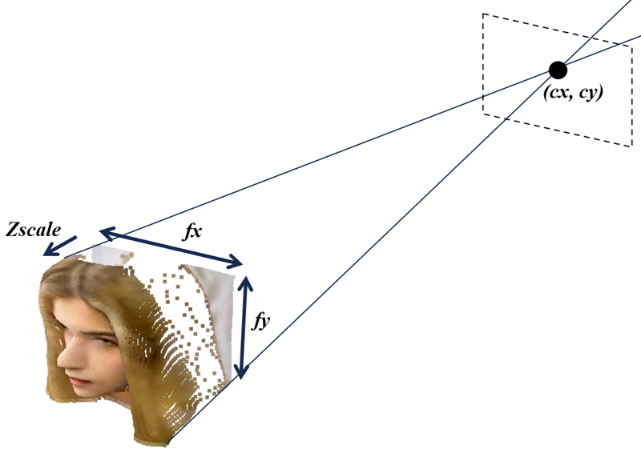
            <table border="1">
                <tr><th>操作</th><th>機能</th></tr>
                <tr><td>左ボタン押下＋ドラッグ</td><td>3Dモデルの回転</td></tr>
                <tr><td>ホイールボタン押下＋ドラッグ</td><td>3Dモデルの移動</td></tr>
                <tr><td>ホイール回転</td><td>3Dモデルの拡大・縮小</td></tr>
                <tr><td>PrintScreenキー押下</td><td>スクリーンショット保存</td></tr>
                <tr><td>ウィンドウ閉じるボタン押下　</td><td>プログラム終了</td></tr>
            </table>
            <h3>使用例</h3>
            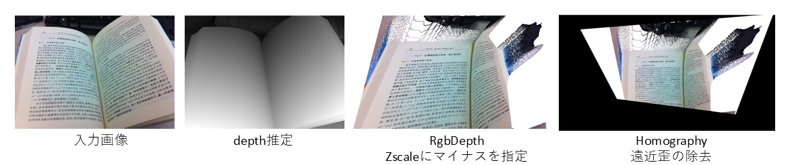             
        

        <h2>RGB画像からdepth画像の作成例</h2>
        <h3>depth推定ソフトウェアで画像からdepth画像を作成する。</h3>
        

            Depth Anything V2 などを使って画像からdepth画像を作成する。 
            <a href="https://huggingface.co/spaces/depth-anything/Depth-Anything-V2">https://huggingface.co/spaces/depth-anything/Depth-Anything-V2</a> 
             
            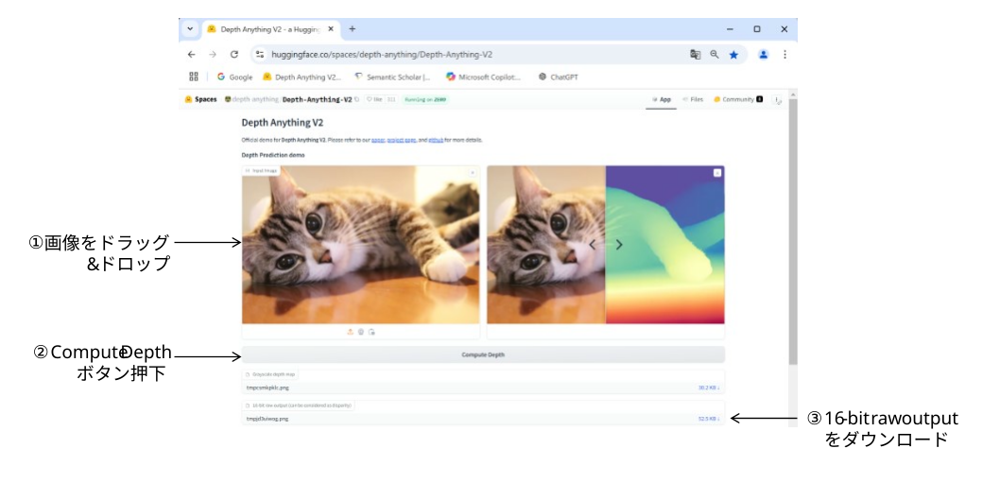
        

<h2>DepthPro 2 を試してみた</h2>
入力画像
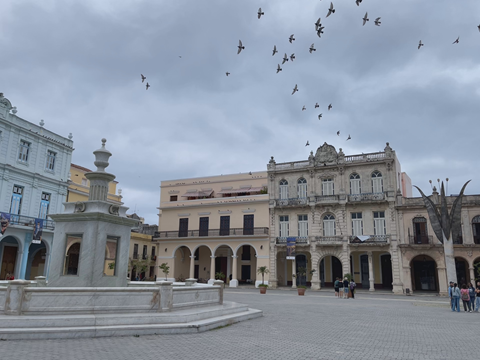
点群化　例１
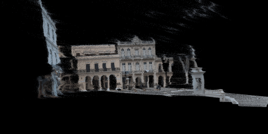
点群化　例２
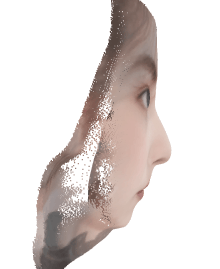

(環境構築) 
・https://github.com/apple-aiml-research/ml-depth-pro-2 
　Code --> Download ZIP 
・ml-depth-pro-2-main.zip を解凍する 
・cd ml-depth-pro-2-main 
 
・conda create -y -n depth_pro_2 python=3.10 
・conda activate depth_pro_2 
・pip install av 
・pip install numpy 
・pip install timm 
・pip install pillow_heif 
・pip install opencv-python 
 
・src_depthpro2\test_depth_pro_2_img2npy.py を ml-depth-pro-2-main\src フォルダに配置 
 
・DepthPro2で画像から深度データを作成する 
　src_depthpro2\test_depth_pro_2_img2npy.py　(画像ファイル) 
　src_depthpro2\test_depth_pro_2_img2npy.py　(画像ファイルへのワイルドカード 例：*.png) 
　src_depthpro2\test_depth_pro_2_img2npy.py　(画像ファイル1)　(画像ファイル2)　･･･ 
 
・最初の実行時に3.25GBのパラメータがダウンロードされる。 
・CPUでも数分で推定完了 
・メートル単位で深度が推定される。屋外画像などでは inf も含まれる 
 
・画像と深度データから点群を作成する 
　src_depthpro2\ImgNpy2Pcd.py　(画像ファイル)　(深度データ(.npy))　[(zスケール)] 
　sキー押下で点群データが displayed.ply に保存される 
 
・使い勝手が悪いが、以下のツールで余計な点を削除した 
　<a href="https://github.com/boyoyon/PLY_EDIT">src/pcd_edit.py</a> 　
　src\axisXYZ.ply、src\plane_x0.ply、src\plane_y0.ply、src\plane_z0.ply も必要 
　(console) 
　　L　(点群 plyファイル) ･･･ 点群 ply をロード～スケーリングする 
　　※ 点群が大きすぎたり小さすぎたりすると編集できないので、大文字 L でロードした場合は 
    　　スケーリングすることにした。 
　　l　(点群 plyファイル) ･･･ 点群 ply をロード (スケーリングなし)     
　(visualizer) 
　　削除したい点と残したい点を面で分離できるように、点群を回転、平行移動する 
     
　　1キー：x軸周りに点群を回転　+shiftで反対周り、+ctlで高速回転 
　　2キー：y軸周りに点群を回転　+shiftで反対周り、+ctlで高速回転 
　　3キー：z軸周りに点群を回転　+shiftで反対周り、+ctlで高速回転 
　　4キー：x軸方向に平行移動　+shiftで反対方向、+ctlで高速移動 
　　5キー：y軸方向に平行移動　+shiftで反対方向、+ctlで高速移動 
　　6キー：z軸方向に平行移動　+shiftで反対方向、+ctlで高速移動 
　　7キー：回転ステップを小さくする　+shiftで大きくする 
　　8キー：平行移動ステップを小さくする　+shiftで大きくする 
　　↑↓キー：スケールアップ／ダウン 
　　aキー：座標軸　表示/非表示 
　　xキー：x平面　表示/非表示 
　　yキー：y平面　表示/非表示 
　　zキー：z平面　表示/非表示 
 
  (console) 
　　remove　x：　x>0 の点を削除する 
　　remove　-x：　x<0 の点を削除する 
　　※ y、-y、z、-z も同様 
 
　　save　(plyファイル名)：編集した点群をセーブする

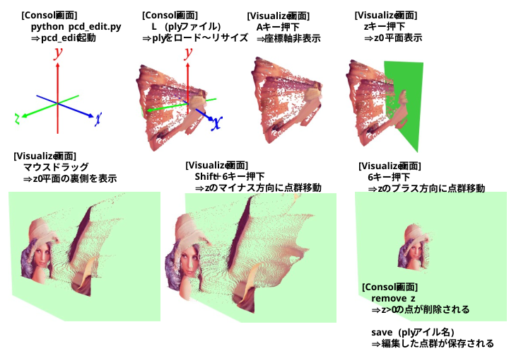

・点群plyを表示する 
　src2/o3d_display　(plyファイル)　[(z値スケール)] 
     
　　bキー：背景の白/黒トグル 
　　1~3キー：カメラ(視点)の回転　+shift：逆方向回転　ctl:回転量増加 
　　4~6キー：カメラ(視点)の平行移動　+shift:逆方向移動　ctl：移動量増加 
　　7キー：回転ステップを下げる　+shift:上げる 
　　8キー：平行移動ステップを下げる　+shift:下げる 
　　↑↓：ズームイン/アウト 
　　sキー：点群を displayed.ply に保存 
　　----- 
　　マウスドラッグ：カメラ(視点)の回転 
　　ホィール回転：ズームイン/アウト 
　　ホィールを押してドラッグ：カメラ(視点)の移動 
　　-, ^:　点を小さくする/大きくする 
　　@, [： 視角を狭める、広げる 
　　p：スクリーンキャプチャー 
　　ESCキー：終了

<h2>YOLO26n-depthを試してみた</h2>

(準備) 
・モデルの重みをダウンロードする 
　<a href="https://platform.ultralytics.com/ultralytics/yolo26/yolo26n-depth">https://platform.ultralytics.com/ultralytics/yolo26/yolo26n-depth</a> 
　clone model をクリックし、yolo26n-depth.pt(12.7MB)をダウンロードし、src2フォルダに格納する 
・pip install opencv-python open3d ultralytics

(試し方) 
・画像から depth 画像を作成する 
　python src2/estimate_by_yolo26n-depth.py (画像ファイル) 
  カレントフォルダに 画像ファイル_depth.png という名前でdepth画像が作成される。 
・RGB画像、depth画像からplyファイルを作成する 
　python　src2/RgbDepth2ply.py　(RGB画像ファイル)　(depth画像ファイル) 
 
顔は歪んだ平面になる･･･

        
<h2>Lotus-2が良さそうだったので試してみた</h2>
        

            Lotus-2という深度推定器はなかなか良さそう。
        

        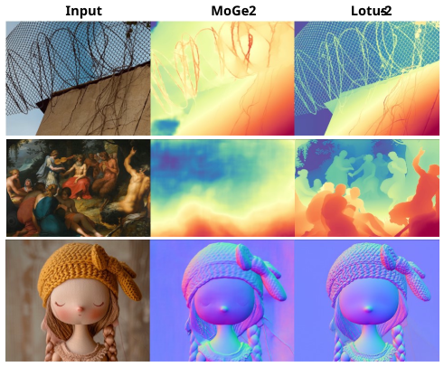
        

            Githubでコードが公開されているが、GPUメモリ40GBなどと記されており諦めてWEBデモを試してみた。 
            ・出力がグレースケールではなく、ヒートマップ表示だったので, 泥臭くdepth画像に変換してみた。 
            ・もっとスマートな方法があるとは思うが、やりかたを知らないので･･･ 
             
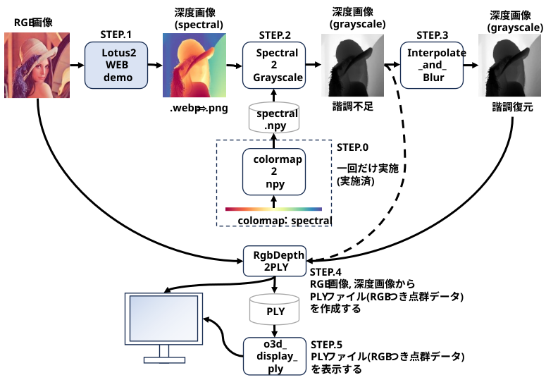 

<h3>　STEP.0　カラーマップから色相の配列を作成する</h3>

　　python src2\colormap2npy.py  
　　この処理は一度実施するだけでよい(実施済) 
     

<h3>　STEP.1　Lotus-2 の WEB デモで画像から深度画像を作成する</h3>

　　<a href="https://huggingface.co/spaces/haodongli/Lotus-2_Depth">Lotus-2のDepth推定デモページ</a> 
　　カラーマップ(Spectral)の深度推定結果が得られる。 
    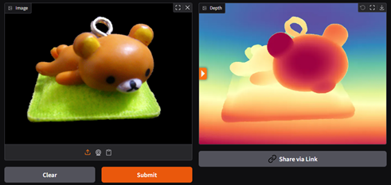 
　　・画面右上のダウンロードボタンを押して深度画像をダウンロードする。 
　　・MS Paintなどでダウンロードした深度画像(.webp)を .png に変換する。 

<h3>　STEP.2　カラーマップ(Spectral)の深度画像をグレースケールの深度画像に変換する</h3>
           

　　python src2\Spectral2Grayscale.py (Spectral Depth Image) 

    
<h3>　STEP.3　深度画像を補間する</h3>

　　カラーマップをグレースケールにした深度画像は諧調数が少なく深度にギャップができるので, 補間～ぼかしにより諧調を復元する。 
 
 　　python src2\interpolate_and_blur.py (グレースケール深度画像) [(ぼかすレベル)] 
 
　　※ 1ラインずつ2パス処理するので時間が掛かる･･･ 

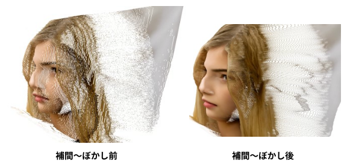
 
　　※ 鼻のあたまが掛けているのは Lotus2の推定深度が飽和しているため 

<h3>　STEP.4　RGB画像, 深度画像からPLYファイルを作成する</h3>

　　python src2\RgbDepth2PLY.py　(RGB画像) (深度画像) 

<h3>　STEP.5　PLYファイルを表示する</h3>

　　python src2\o3d_display_ply.py　(PLYファイル) [(z値スケール)] 
 
　　・<strong>マウスドラッグ</strong>：　点群の回転 
　　・<strong>ホイールボタン＋マウスドラッグ</strong>：　点群の移動 
　　・<strong>`@`キー, '['キー</strong>：　表示画角変更 
 
　　・<strong>'-'キー,'＾'キー</strong>：　点群のサイズ変更 
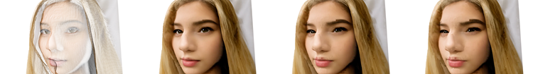 
　　・<strong>pキー</strong>：　スクリーンキャプチャー 
　　・<strong>1/2/3キー</strong>：　点群の回転,　<strong>＋Shiftキー</strong>：　逆回転,　<strong>＋Ctrlキー</strong>：　回転量10倍 
　　・<strong>4/5/6キー</strong>：　点群の平行移動,　<strong>＋Shiftキー</strong>：　逆方向に行移動　<strong>＋Ctrlキー</strong>：　移動量10倍 
　　・<strong>7キー</strong>：　回転ステップを下げる,　<strong>＋Shiftキー</strong>：　回転ステップを上げる 
　　・<strong>8キー</strong>：　平行移動ステップを下げる,　<strong>＋Shiftキー</strong>：　平行移動ステップを上げる 
　　・<strong>ESCキー</strong>:　終了　

<h3>ply表示</h3>

python　src2\o3d_display.py (plyファイル)　[(zScale)] 
・Line Set PLY / Point Cloud PLY / Triangle Mesh PLY を表示可能 
・1/2/3/4/5/6キー押下：オブジェクトの回転、平行移動 
　　　　　　　　　　　　+shiftで反対方向に回転、平行移動 
    　　　　　　　　　　+ctrlで回転量、平行移動量up 
・7/8キー押下：回転量、平行移動量を小さくする/大きくする 
・↑/↓：オブジェクトの拡大/縮小 
・sキー：plyにセーブ
(Visualizerの元々の機能はhキー押下でコンソールに表示される) 
(例)
・Lキー押下：ライティングのon/offをトグル 

<h3>pcd→mesh</h3>

python src2/PointCloud2Mesh.py (pcd PLY) 
・裏返しに変換される場合は、-reverseをつける 
　python　src2/PointClound2Mesh.py (pcd PLY) -reverse

</body>
</html>
